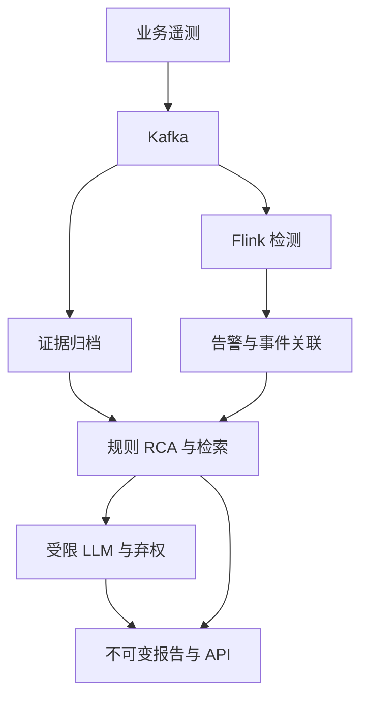

# AIOps Research Platform

面向微服务的证据约束 LLM 根因诊断平台：让检测、引用、弃权与失败都能被复核。

    

**交付状态：可运行的研究实现与实测材料；并非提示词包全部门禁通过。** 公共检测基准已完成，本地质量通过；人工复核、远端 CI、容器/三节点部署、真实集群故障和长时规模实验仍未通过。详见 [验收对照](docs/release/ACCEPTANCE.md)。

| 实测范围 | 主结果 | 解释 |
|---|---|---|
| SMD / MAD vs ZScore | AP [0.3235 vs 0.2894](research/results/p0-smd-03/result.json) | [Wilcoxon p=0.125](research/results/p0-smd-03/result.json)，不声称显著优越 |
| PSM / 流式 POT 变体 | point F1 [0.0123](research/results/p0-psm-03/result.json) / PA F1 [0.8496](research/results/p0-psm-03/result.json) | PA 明显放大稀疏命中，必须联合报告 |
| LLM 0.5B（合成故障） | Top-1 [0.0000](research/results/p1-05b-01/result.json) | 原始攻击率 [0.1667 → 0.0000](research/results/p1-05b-correction-02/result.json) |
| LLM 1.5B（合成故障） | Top-1 [0.2500](research/results/p1-15b-01/result.json) | 原始攻击率 [0.0667 → 0.0333](research/results/p1-15b-correction-02/result.json) |
| 工程回归 | [509 通过，10 跳过，覆盖率 87.93%](research/results/p2-quality-counts-01/result.json) | [完整日志](research/results/p2-quality-final-03/tests.log)，远端 CI 未运行 |

```bash
# 解压交付包后，在 aiops-research/ 根目录（Python 3.11 或 3.12 + make）
make demo
```

会新建虚拟环境、按运行时锁文件安装依赖并启动短时回环 API 验证。默认结果目录 `/tmp/aiops-demo-时间戳` 必须不存在。需要首次网络下载依赖；演示数据是合成数据，不下载公共数据或模型。实测 [干净 Python 3.12 虚拟环境](research/results/p4-demo-clean-312-03/result.json) 中入库与 API 校验通过；**未在新容器中验证**。未发布外部 Git 地址，因此不提供虚构的 `git clone` URL；可用包内 git bundle 还原真实提交历史。



图示为系统路径。真实原生 Kafka/Flink、本地 GGUF、恢复和短时性能步骤见 [最终验收](research/results/final-acceptance-02/result.json)；演示命令走轻量本地路径。Online Boutique / OTEL / Chaos Mesh 为待集群验证的扩展，不冒充已部署。

## 导航

- [公共检测结果与 PR 图](research/results/RESULTS.md)、[方法与统计口径](research/METHODS.md)。
- [LLM 主表、四图、失败案例](research/llm/RESULTS.md)、[实验协议](research/llm/PROTOCOL.md)。
- [技术报告 PDF](docs/release/research-report.pdf)、[A4 项目简介](docs/release/project-brief.pdf)。
- [五分钟真实执行录像](demo/aiops-five-minute.mp4)、[逐字稿及录制说明](demo/script.md)。
- [部署与真实集群实验](deploy/README.md)、[API 迁移](docs/release/API_COMPATIBILITY.md)。
- [简历条目](docs/release/resume.md)、[中文博客大纲](docs/release/blog-outline.md)。
- [证据与版本溯源](docs/release/PROVENANCE.md)、[最终独立审计](docs/research/audit-final.md)。

## 公共实验复现

```bash
make research-env
.venv/bin/python -m scripts.research.download --dataset all --output data/public-reproduction
.venv/bin/python -m scripts.research.evaluate_detectors --dataset smd --data-root data/public-reproduction/smd --output /tmp/smd-reproduction-01
.venv/bin/python -m scripts.research.evaluate_detectors --dataset psm --data-root data/public-reproduction/psm --output /tmp/psm-reproduction-01
.venv/bin/python -m scripts.research.verify_results --help
make check
```

下载参数以 [download.sh](research/datasets/download.sh) 为准；数据固定上游提交并校验每文件哈希。SMD 采用预先指定的字典序前五台机器，PSM 排除时间戳列。所有方法仅用训练数据定阈值。完整权重与公共原始数据不进仓库；所有评估的 scores/labels/predictions、原始模型输出、日志与命令均在交付包中。

LLM 复现请先阅读协议及冻结测试运行锁。训练/开发调参与保留测试严格分开；不删锁来重复调同一测试集。新模型/新协议应使用新实验 ID 与新保留集。权重来源与 SHA256 见两个模型的 result.json；默认不外发数据。

## 工程约束

`/v1` 与旧 API 并存。为保留现有客户端和既有测试，旧路径默认维持返回语义并加弃用头，GET/HEAD 的 301 可通过环境变量开启；这是对“默认 301”的明确偏离。Bearer 认证先于限流；限流按规范路由与直连 IP 分桶，未知路径不增长无限标签。SQLite 单写进程约束：同 Pod 共享卷、单副本；不能配置多个独立副本并宣称高可用。

Ruff、mypy、覆盖率门禁均本地执行，并有隔离红→绿探针。`Any` 保留在历史动态 JSON 接口边界，类型标注不是完整结构化建模。CI 配置包含 Python 矩阵和不可忽略的代码门禁，Docker job 可选；徽章明确显示远端 CI 未运行。

## 局限与原始产物

小规模单主机实验、合成 RCA 标签、未完成人工复核、未做多租户隔离与生产高可用。没有把规则根因排名当作 LLM 准确率；没有把空引用当成“零幻觉”。P3 缺真实集群的注入与资源证据，MTTD/MTTR/规模结论留空。

原始 phase10 历史材料在 `docs/historical/` 说明，旧文档的数字不是本轮结果。原始大包已外置：[原上传项目](https://chatgpt.com/library?file_id=libfile_f7eec5a11ebc8191ab154db8632dad6e&account_id=personal)。本轮完整验收数据库与 Kafka 文件在交付包根目录 `acceptance-full-evidence.zip`，其逐文件哈希见 [ARCHIVE_MANIFEST](research/results/final-acceptance-02/ARCHIVE_MANIFEST.json)。不删除失败记录。

## English quick guide

Evidence-grounded RCA for microservices. Public anomaly benchmarks are real downloaded data; RCA and prompt-injection labels are synthetic and not human-reviewed. Run `make demo` from this directory for a local HTTP smoke test. Read [the measured detector results](research/results/RESULTS.md), [LLM results](research/llm/RESULTS.md), and [acceptance limitations](docs/release/ACCEPTANCE.md) before making claims. Native Kafka/Flink and model integration passed their executed checks. Remote CI, Docker/kind deployment, real cluster chaos and sustained scale gates remain unpassed. The tiny models' abstention and low diagnostic utility are retained as negative results, not hidden by schema-validity scores.
