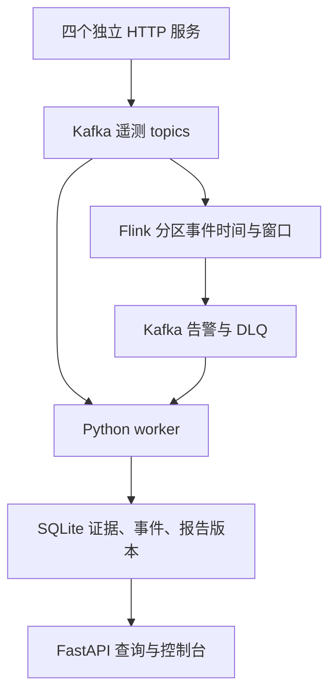

# 第一阶段架构与可靠性边界

保持既有API、事件schema v1、SQLite表、规则检测与版本报告，增加真实流处理验证和必要防护。新的Flink拓扑UID为v3，不能恢复旧v2状态。此文件描述已实现的结构，实测范围和通过数量以阶段验收报告及机器结果为准。

Flink source的小型Java桥接保留原topic/partition/offset/timestamp，执行严格UTF8解码和时间安全guard。watermark在Kafka source按分区生成，Python使用统一契约做完整校验，再进入有界去重和服务滑窗。SQL connector包含shaded Kafka客户端，所以桥接须以固定版本实际编译，不能直接套普通Kafka包名。

聚合继续保留25ms直方图与精确ID映射；P95>800ms决策可与Python精确规则对照，不能把数值近似称为完全相同。全流静默不推进事件时间，迟到按每个重叠窗口判断。容量拒绝、冲突、过迟和非法输入均可观察，不用重启代替坏消息隔离。DLQ超过128KiB显式截断并保留哈希及回查坐标。

worker从原遥测、Flink告警和DLQ主题消费。一个poll的有效事件与告警持久化完成后才提交offset，DB或提交错误不继续读下一批。完全重复canonical事件忽略；冲突事件不覆盖首条并保留冲突来源。持久化事件/告警幂等，不代表快速检测内存状态恰好处理一次。

既有Pipeline负责快速预警、事件关联、初报/补证/恢复版本；规则诊断和案例检索保留。LLM适配器当前仍是既有OpenAI兼容实现，本轮没有配置或调用真实模型；其已知问题在现状审计中，属于下一阶段。历史案例仍为人工编写示例，不计为真实事故知识库。

`/health`用于API存活，`/ready`分别探测Kafka、全部Flink算子及worker新鲜心跳；不能用API存活替代流就绪。后台模型/报告任务不占Kafka poll线程。worker信号停止、重试预算、失败状态文件与Compose重启策略可观察，但持续依赖故障可能形成进程级重启循环，不是无条件自愈。

## 持久化与恢复

| 状态 | 持久化 | 已知边界 |
| --- | --- | --- |
| Kafka已确认消息 | broker本地日志 | 单副本，无跨节点高可用；producer未确认失败无磁盘spool |
| Flink source offset / 去重 / 窗口 | 完成的checkpoint | v3内部恢复；JobManager无HA，新版本/配置变更需兼容评估 |
| 事件/告警/报告/通知箱 | SQLite WAL | 单实例数据库；API与worker共享文件；未实现外部数据库容灾 |
| 快速检测连续错误状态 | 进程内 | 重启丢失，落库后检测前崩溃可能漏快速预警 |
| DLQ大消息原文 | 源Kafka坐标回取 | 128KiB后仅前缀/哈希；SQLite deadletters仍可能100KB截断；非完整归档 |
| 冻结报告证据 | 既有最多1800条快照 | 分页完整集/manifest/保留归档尚待阶段8，不能称证据完整 |

故障注入只针对隔离HTTP模拟服务，标签不送入诊断上下文。原生测试包括精确构造的合成事件与真实HTTP请求，不把前者称作生产遥测。实验恢复时间仅是本次环境测量，不是性能SLA。原生多进程验证并不等于Docker Compose、跨主机部署或生产高可用已经验收。
