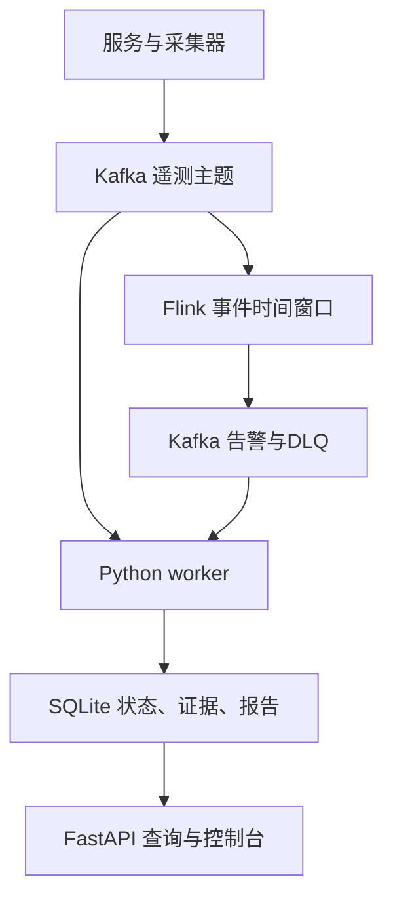
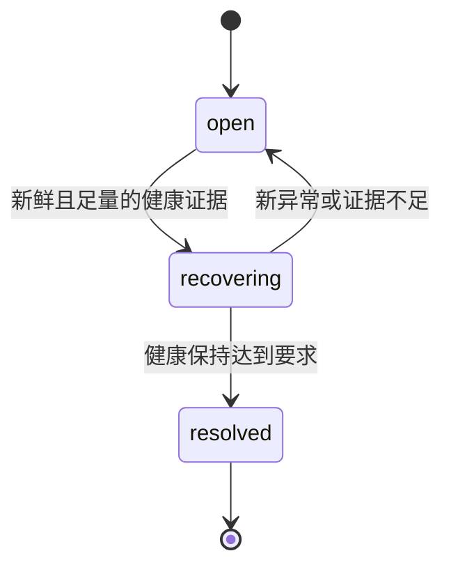

# 修复版架构与数据语义

部署和复测命令见[部署指南](deployment.md)。本次在原项目上修改边界与验证逻辑，保留API、schema-v1遥测、现有SQLite表和v2报告读取方式。以下描述实现，不替代[最终验收报告](acceptance-report.md)中的实际运行结论。

## 1. 两条执行路径

原生/容器数据路径：

Flink消费指标主题；worker同时消费指标、日志、跨度、告警与死信，保留Kafka topic/partition/offset来源。快速连续5xx检测是worker中的补充通道，不能与Flink窗口重复混算成不同故障。

本地模式由 `scripts.local_platform` 启动 API和gateway/order/inventory/payment独立HTTP进程，遥测通过 `/demo/ingest` 入库，Python进行窗口检测；它复用事件、RCA、模型预算和报告模块，但不运行Kafka/Flink。微服务调用方向为gateway→order，order按业务路径调用inventory和payment；业务故障与控制面故障注入分别记录。

## 2. 统一事件与投递语义

| 字段/通道 | 语义 |
|---|---|
| `schema_version=1` | 保留已有JSON事件版本 |
| `event_id` | 业务幂等ID；同ID相同内容可重放，冲突内容记录死信，不覆盖先到内容 |
| `event_time` | UTC epoch毫秒，严格整数；无效或过度超前时间不能推动Flink水位 |
| `service` / `instance_id` | 服务和实例标识，不能把服务候选直接当成已证明内部机制 |
| `event_type` | request、host、span、log；各类型字段由共享契约验证 |
| `trace_id`、span/parent标识 | 关联调用链；兼容旧事件的缺失trace，但缺失不能凭时间相近补造调用关系 |
| `telemetry.metrics/logs/spans` | 指标、日志、跨度输入主题 |
| `ops.alerts` / `ops.deadletter` | 检测结果及无效、冲突、迟到/容量等异常输入审计 |

worker先提交SQLite持久化，再提交Kafka offset；失败不会把未持久化消息当作处理完成。事件/告警稳定ID与数据库约束使重放幂等。Flink内部checkpoint状态语义与Kafka sink至少一次并存，**没有端到端exactly-once承诺**。

默认30秒窗口、10秒滑动、5秒乱序容忍；超过已推进水位的迟到事件进入DLQ，不自动修正已结束窗口。Flink使用25ms延迟直方图，Python精确分位数对照可能有桶精度差异；超出普通范围会显式标识精度限制。去重默认TTL300秒、64桶×每桶1000项；这是配置容量边界，不是吞吐实测，哈希不均匀可能先使单桶满。容量溢出进入DLQ，必须在长测中统计，不能忽略。

checkpoint与TaskManager恢复支持实际验证；全JobManager故障、多节点调度、磁盘损坏、跨机容灾没有因此自动获得保证。v2/v3状态UID不兼容，不能拿旧checkpoint直接恢复新拓扑；升级应按已有指南备份并评估重放。

## 3. 关联、RCA与恢复

事件关联先分页读取告警服务的种子，再按相关trace分批读取，避免全局20,000条无关事件遮蔽已有根因证据。默认每页256条、每次seed/trace扫描最多20,000条及8MiB、最多1000个trace；预算在 `IncidentManager` 构造参数中验证，未新增远程任意修改接口。

`correlation_coverage`记录范围、页数、字节和截断原因。完整仅指声明查询范围，不表示全库/全trace生命周期或所有Kafka主题到齐。达到硬上限时保守保留不完整状态，不确认唯一根因或自动恢复；此经历不会被后续小窗口静默抹掉，仍需显式重新分析。当前没有新增人工关闭事件或实例退役管理接口，不能把这项保守限制描述为已完成的人工处置流程。

RCA根据真实父子span、同链错误传播、自身异常和延迟残差产生多个候选，区分直接异常、根因候选与受影响服务。规则分数只用于排序，不是因果概率；历史案例匹配和模型意见作为可追溯补充，不覆盖规则排名。时间接近本身不构成因果关系。

恢复要求窗口覆盖、样本量、新鲜度、无异常及完整查询；根因实例需要其指标，健康span不能冒充请求样本。恢复期间受影响服务任一实例的新鲜失败span会否决并重置保持，引用有上限且显式标截断。过旧、未来和无关服务span不会阻断。服务级恢复不是“每一个历史实例均已恢复”；缺失旧实例记录也不能自行推断其仍故障。已结束事件不会自动重开处理任意迟到证据。

## 4. 模型选择、事实约束与规则回退

上下文包含有界指标、日志、跨度、时间线、关联告警和案例；每次记录模型、提示词/协议版本、证据集ID、耗时及预算。独立故障注入标签不进入模型上下文；真实告警的服务名仍是观测事实。

| 模型输入/输出方式 | 保留行为与限制 |
|---|---|
| `analysis-v2` | 保留既有供应商JSON协议；真实服务/引用及异常观测校验后，保存原始输出，再把不可验证文字与可核对事实区分 |
| `evidence-selection-v1` | 模型选择、排序真实异常证据短键及受控验证/处置动作；平台将选择映射到原v2报告，不用规则候选代替模型选择 |
| `grounded_observations` | 只表示选定异常观测经校验；内部机制未知，模型置信等级上限low，原始等级与转换审计保留；不是“内部根因已证明” |
| unknown / 回退 | 健康、证据不足、非法引用、协议错误、超时、限流或预算耗尽允许弃权/规则回退；不强行生成确定内部原因 |

单事件调用预算与结果持久化，有限重试；超时不因不知道服务端是否已计费而无条件重试。未配置模型时规则路径可运行。模型建议不会自动执行运维动作。上述有限事实门禁不是通用自然语言证明器，生产效果需单独标注集和统计评估。

## 5. 证据、版本与持久化

核心 Python 服务支持3.11 / 3.12；CI、Docker及独立PyFlink/本地模型以3.11为基准。版本检查只限制未支持解释器，不解决存储目录风险。当前工作区有主动双向同步，已捕获rsync在数据库运行中替换WAL/SHM文件；3.11也出现过真实数据库损坏；相同脚本移至 `/tmp` 的独立WAL/DELETE实验通过，已撤回先前的3.12版本归因。

**活跃SQLite DB/WAL/SHM必须放在本机非同步持久磁盘目录**，如已确认不受同步工具管理的 `$HOME/.local/state/aiops-platform`。跨进程锁协调平台自己的连接，不能阻止外部同步程序替换inode或改写DB/WAL/SHM；WAL换成DELETE也不构成修复。隔离验收使用 `/tmp/aiops-...`，关闭全部写入进程、检查完整性后才复制静态成果至项目artifacts。已有数据库不自动移动或修复，应先保留现场和一致备份，再验证独立目录恢复；临时目录不承诺长期保留。

SQLite保存原始事件、事件生命周期、规则状态、报告版本、模型预算、完整冻结证据和迁移审计。初始化用跨进程锁序列化；已有库需改变基础DDL/日志模式或附属对象时先做在线一致备份，失败中止。旧报告不原地重写，旧模型结果被新版本复用时应用新门禁并记录归一化。

| 标识/完整性 | 保留的含义 |
|---|---|
| `snapshot.full_evidence.set_id` / `audit.full_evidence_set_id` | 冻结事务已入库且匹配查询的完整证据集 |
| `audit.evidence_set_id` | 模型实际输入的证据集，可能更小 |
| `rca.evidence_set_id` | RCA分析快照标识 |
| `analysis_sampled` / `analysis_truncated` | 分析快照最多1800条，完整保存不代表模型分析全部 |
| `legacy_unknown` | 老报告缺少完整集信息，不用今天的数据伪造历史完整性 |

完整集按批复制/哈希、游标分页读取，默认200条、最多500；支持服务、时间、事件类型、事件ID、trace筛选。历史报告分页与版本比较保留原接口，新增全量变更计数和有限ID样例。哈希校验检查内容、顺序、字段、样本归属和引用清单；它是本地一致性校验，不是外部数字签名或跨主题完成水位。

原始事件保留清理由本机CLI显式启动，默认dry-run；应用时先备份、归档、回读校验，再删除一个受保护条件约束的有限批次。冻结集、历史报告和备份没有自动无限淘汰策略，需要监控磁盘。所有缓存/查询预算与失败状态应在报告中可见。

## 6. 控制面与可信边界

FastAPI保留 `/live`、`/health`、`/ready`、`/incidents`、报告版本、证据、拓扑和故障控制等接口。API采用本地模式或三类Bearer令牌，摄取/读取/控制分开；请求体有容量及总读取时限，跨源写入检查、日志已知密钥脱敏、422不回显原输入。

所有发布端口默认回环；远程或多人暴露必须认证授权及TLS/网络控制。共享令牌不是完整用户身份系统，控制台没有交互登录，Kafka/Flink REST不受API令牌保护。模拟器控制有独立token，CPU/内存压力没有默认远程耗尽接口。风险操作只在授权隔离测试中执行，不能从“本地有token”推导整个系统已经安全公开。

## 7. 评估结果如何解释

固定/动态检测在同一有标签数据上报告TP/FP/TN/FN、精确率、召回率和检测时延；弃权不会从分母悄悄删除。RCA报告Top-1/Top-3及unknown，构造案例共享家族，不能称生产泛化准确率。

HTTP测量分离handler/下游、遥测发布和总观测耗时；验证每个trace的服务、request/span/log及父子关系。无注入但实测慢请求会使健康对照受阻，实际观测仍保留；缺失证据和定位错误失败，不能被blocked掩盖。

Flink测量真实Kafka→Flink窗口→Kafka告警→SQLite路径，区分输入发送速率与全部窗口排空后的完成速率，自然关闭与控制水位尾窗时延分开。CPU/RSS只覆盖记录的主进程PID，未覆盖所有派生PyFlink子进程；Kafka lag采用checkpoint提交offset口径。短测不代表最大容量或长稳可靠性。

统一runner按每类结果显式契约判定，空/未知/矛盾结果失败；源码清单覆盖执行代码、案例、配置和测试数据，外部运行时与凭据不伪称已包含。未执行门禁为blocked；模型真实调用、替身单测、静态检查及理论配置量均分别记录。
