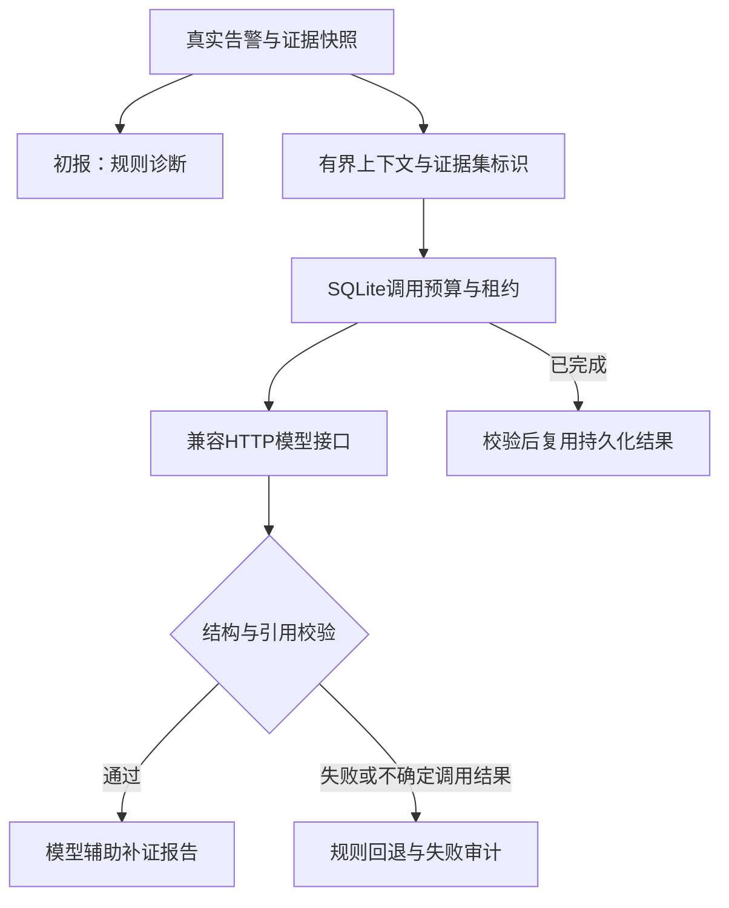

> 后续修订：提示词、CPU线程及解码配置已更新，见[继续修复记录](继续修复记录.md)。原实测失败记录保持不变。

# 第二阶段：证据驱动的模型诊断

本阶段在第一阶段代码上增量实现。Kafka/Flink、HTTP服务、事件ID、证据快照和既有报告查询接口保留。旧报告不迁移、不改写；新模型结果使用 `analysis_schema_version=2`。第一阶段审计和验收记录仍是历史记录，本阶段实测以同目录验收报告及 `artifacts/phase2/` 为准。

## 调用路径



模型结果允许 `unknown`；这仍需包含不确定性、验证步骤和建议。引用存在只证明可追溯，不证明推理或因果关系正确。置信度为 low/medium/high 判断等级，附文字依据与支持证据计数，不冒充校准概率。

上下文包含异常请求指标、服务日志、span与父子关系、时间线、实际关联告警、最多3份匹配案例、Kafka来源坐标、覆盖与截断标记。`cases/`仍为明确标注的人工示例，未变成生产历史库。案例内容增加冻结SHA-256，案例ID不能作为观测证据ID。

## 连接自己的服务

复制 `.env.example` 为 `.env`，在本地安全编辑地址、模型及密钥，再启动 `python -m scripts.local_platform`。环境变量优先。不要提交 `.env`。直接运行worker或集成脚本时需由进程环境提供变量；脚本不自动读取 `.env`。

适配器请求 `LLM_BASE_URL/chat/completions`，地址通常以 `/v1` 结尾。不依赖厂商SDK。密钥通过Authorization头发送；地址禁止携带凭据、查询串或fragment。默认关闭环境代理，确需代理时设置 `LLM_TRUST_ENV=true`。模型服务必须允许此网络来源，容器内localhost指向容器自身。

`.env.example`列出完整设置：

| 设置 | 默认值与含义 |
| --- | --- |
| `LLM_TIMEOUT_SECONDS` / `LLM_TOTAL_TIMEOUT_SECONDS` | 20 / 30秒；单次HTTP与包含重试的绝对时限 |
| `LLM_MAX_ATTEMPTS` / `LLM_MAX_CALLS_PER_INCIDENT` | 2 / 2；最多3次尝试，事件硬上限最多5次 |
| `LLM_REQUESTS_PER_MINUTE` | 10；同一个SQLite数据目录共享的固定分钟桶 |
| `LLM_RETRY_BACKOFF_SECONDS` | 0.5；Retry-After最多等待5秒 |
| `LLM_MAX_CONTEXT_RECORDS` / `LLM_MAX_CONTEXT_BYTES` | 48 / 64000；证据记录数与序列化上下文字节上限 |
| `LLM_MAX_RESPONSE_BYTES` / `LLM_MAX_TOKENS` | 1000000 / 1500；响应与生成token上限 |
| `LLM_RESPONSE_FORMAT` | none；可选json_object、json_schema，需服务支持 |
| `LLM_INPUT_PRICE_PER_MILLION` / `LLM_OUTPUT_PRICE_PER_MILLION` | 空；自行填写供应商每百万token价格 |
| `LLM_COST_CURRENCY` | USD；费用估算币种 |

默认30秒总时限适配Compose worker的45秒关闭宽限。提高总时限时，应把worker关闭宽限设置为总时限加至少10秒；本地控制台有较短的强制停止时限，中断中的调用将按未知结果保守处理。CPU验证脚本使用独立的500/530秒HTTP/总时限、服务端480秒推理时限，不代表平台默认设置。

只有429/502/503/504及特定网络连接错误可有限重试。认证错误、非法输出、引用错误和超时均回退；超时可能已经被供应商处理或计费，故不自动重试。没有配置也能生成规则报告。限流失败不等待无限队列。输出过大、压缩响应、重复JSON键、NaN、截断输出、缺字段均拒绝。

## 持久化与兼容性

新建 `model_jobs`、`model_calls`、`model_rate_limits`；首次建表前必须完成在线SQLite备份，保存到数据目录 `backups/before-model-budget-v2-*.sqlite3`。不删除或ALTER原表，保留旧 `incident_model_attempts` 已用调用记录。第一阶段整个交付包另备份在项目 `backups/`，哈希见 `backup.json`。

每次实际HTTP尝试前原子预占预算，调用结束记录耗时、结果码和用量。验证后的结果先写模型任务表，再发布报告；重复报告和重启可复用。租约过期且已预占HTTP调用时，结果为 `indeterminate`，不猜测供应商是否完成，不再次花费预算。尚未预占调用的过期租约只允许接管一次。此策略可能丢失一次已经计费但未落库的答案，优先避免重启重复扣费；没有跨模型服务的exactly-once保证。

HTTP适配器总时限约束请求与重试；SQLite仍使用既有Store的30秒锁等待，在线备份另有10秒时限。数据库故障时，线程清理与持久化耗时可能增加诊断墙钟时间，不能把HTTP总时限当作整个平台的严格延迟承诺。数据库故障与关闭恢复的完整时延评估留待第七阶段。

报告审计保存提示词版本、证据集ID、完整快照哈希、模型名称、所选上下文、选择策略、字段/记录截断、返回文本、验证结果、尝试次数、耗时和用量。已知配置密钥会在保存前脱敏，异常不保存供应商原始错误正文。它不是通用业务数据脱敏系统；发送外部服务前需按实际日志内容建立脱敏策略。

有用量且配置价格才估算费用；任一次用量缺失则总费用保持null，已知部分单列。CPU、内存、电费、供应商账单不在估算内。无价格不得把null显示成0。

证据集ID标识本次冻结快照，不代表完整原始档案。当前证据查询仍有既有数量上限，分页与完整集归档属于第八阶段。模型上下文另有更小上限，必须区分两层截断；本阶段没有声称解决完整证据归档。

## 离线测试

```bash
python -m unittest tests.test_llm_phase2 tests.test_local_llm_server -v
python -m unittest discover -s tests -v
```

HTTP测试替身只用于确定性验证超时、重试、限流、非法结构和不存在的引用，日志与报告标识synthetic/test-double。普通测试不调用收费服务。真实模型和重型Kafka/Flink unittest入口默认跳过，跳过不计通过。

## 独立真实模型集成

已有真实服务配置后执行（输出目录必须是新的）：

```bash
python -m scripts.verify_llm --output artifacts/my-real-model-run
```

无配置退出2并记录blocked；非法结果/规则回退退出1；只有真实返回通过结构与引用校验、持久化及重开验证后退出0。不要把退出2视为成功。也可显式设置 `AIOPS_REAL_LLM_TEST=1` 运行 `python -m unittest tests.integration.test_real_llm -v`，其临时结果不会作为长期交付证据；推荐直接脚本保留产物。

无API密钥时，可在Linux x86_64、支持AVX2/FMA的CPU、建议至少4GiB可用内存、有uv/gcc/g++的环境运行1.5B参考模型：

```bash
python -m scripts.bootstrap_local_model --runtime-dir /tmp/aiops-model-runtime --model-size 1.5b
python -m scripts.verify_llm --output artifacts/my-cpu-model-run \
  --local-model-file /tmp/aiops-model-runtime/qwen2.5-1.5b-instruct-q4_k_m.gguf \
  --model-name qwen2.5-1.5b-instruct-q4_k_m \
  --model-python /tmp/aiops-model-runtime/venv/bin/python \
  --local-context-records 4 --local-context-bytes 6000 --local-max-tokens 1200
```

首次安装会从源码编译llama-cpp-python 0.3.19，可能耗时数分钟；限制编译并行2、推理线程4，不安装系统软件。模型为官方Qwen2.5-1.5B-Instruct Q4_K_M，Apache-2.0，权重1117320736字节；固定版本与SHA-256见脚本MODELS常量。可选0.5B选项也保留作研究对照，但本轮多次真实调用未满足诊断协议，不能视为已通过。模型权重和编译运行时不打入项目压缩包，首次需要联网获取。当前主机已完成源码构建及权重校验；新脚本另执行过现有运行时检查及1.5B权重实际下载，不把缓存检查冒充干净环境重新安装。

独立服务器绑定127.0.0.1、单推理锁、请求262144字节上限、计算与批处理可配置1–8线程（默认4，验证脚本使用--local-model-threads）、480秒推理时限。后续本地解码语法将自然语言字符串上限收紧为160字符，实际枚举ID保留原约束，并把数组上限收紧为2以降低嵌套重复成本、让小模型输出简短；保留类型、必需字段、非空下限及实际引用枚举，不指定诊断结论或候选服务。平台返回校验仍执行完整Schema。输入、响应和生成token独立受限。这个仅用于可选CPU参考服务的限制不会改变其他供应商可返回最多5个候选的正式协议；提示词v2.3建议最多2个简短候选，小模型验证不作为生产RCA准确率结论。

CPU输入规模可用上述三个 `--local-*` 参数控制；它们只影响显式CPU验证模式，不改变正式平台默认配置。减少上下文会降低证据覆盖，报告会记录实际选择与截断情况。

CPU模型、HTTP闭环、Kafka/Flink验收建议依次执行。本次同机并行模型与HTTP闭环时，曾观察到1次inventory遥测发送失败和额外gateway事件，使严格“仅一个故障事件”的验收失败；根因尚未证实，不能用单次串行成功宣称已解决资源隔离。原始失败报告与运行日志保留在 `artifacts/phase2/local-regression/`，后续复测单列新目录。

官方来源：[1.5B模型卡](https://huggingface.co/Qwen/Qwen2.5-1.5B-Instruct-GGUF)、[固定权重版本](https://huggingface.co/Qwen/Qwen2.5-1.5B-Instruct-GGUF/tree/91cad51170dc346986eccefdc2dd33a9da36ead9)。0.5B历史失败使用的固定版本为`9217f5db79a29953eb74d5343926648285ec7e67`。

验证用证据来自第一阶段实际HTTP→Kafka运行的冻结报告，先校验哈希再重放到独立数据库；它是历史实测证据重放，不能称为本次新故障或生产数据。实际模型诊断状态、候选和原始返回必须查看本阶段验收结果。模型和其他子进程由测试脚本启动并清理，失败日志同样保留。


存储访问现使用同库平台会话串行锁（最长等待30秒），备份连接显式关闭。新增filelock固定依赖，升级时停止旧进程后安装新依赖再启动；旧进程和外部SQLite客户端不受此锁约束。原损坏根因未明，保护不等于彻底修复，详见《数据库保护与本轮失败记录》。
