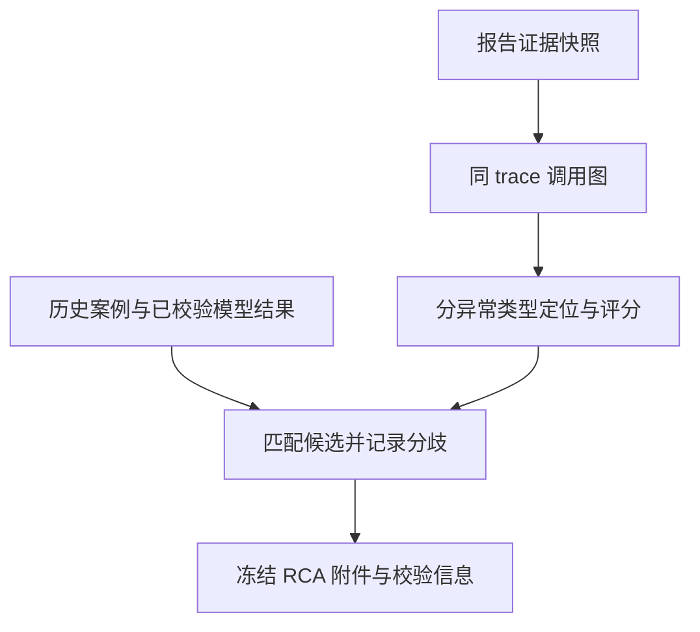

# 第三阶段：根因分析架构与验证指南

本阶段在原有事件、证据快照和渐进式报告上增加 `evidence-graph-v1` 根因分析。它将真实观测到的调用关系、异常类型和证据引用绑定到候选服务，允许多个候选和“无法确定”，不将候选服务直接说成已经证实的内部故障原因。

第二阶段真实大模型诊断仍未通过验收。用户已明确要求先开展第三阶段；本阶段的规则分析、合成算例和历史证据重放不依赖真实模型，也不能替代第二阶段的真实模型成功验证。正在执行或尚未执行的 HTTP、Kafka/Flink 测试应以最终验收报告和对应 `result.json` 为准，本指南不预先认定其通过。

## 1. 在现有系统中的位置

遥测采集、Kafka/Flink 检测、事件关联和报告版本机制继续使用原有实现。新增分析发生在报告已经选定证据快照之后，不重新从数据库选择一套不同证据，也不修改历史报告。



`app/rca.py` 提供统一入口：

```python
analyze(
    snapshot,
    alert=None,
    historical_cases=None,
    model_analysis=None,
    model_metadata=None,
) -> dict
```

`snapshot.records` 沿用已有 `{"event": {...}, ...}` 形式，也可接受直接事件字典。主要读取字段为 `event_id`、`event_type`、`service`、`instance_id`、`trace_id`、`span_id`、`parent_span_id`、`downstream`、`status_code`、`latency_ms` 和主机指标。时间戳仍为现有 `event_time` 毫秒字段，不引入另一套时间单位。

结果主要字段如下：

| 字段 | 含义 |
| --- | --- |
| `rca_version` | 固定为 `evidence-graph-v1`，便于后续算法版本比较 |
| `status` | `candidates` 或 `unknown` |
| `evidence_set_id` | `evidence-` 加完整报告快照的 SHA-256；不是全库证据完整性的承诺 |
| `direct_anomalous_services` | 快照中具有实际异常观测的服务 |
| `affected_services` | 经同 trace、同类异常路径关联到候选的调用方 |
| `candidates` | 候选、分项分数、证据、反证、不确定性和人工验证步骤 |
| `graph` | 服务节点和有依据的 caller → callee 边 |
| `source_integration` | 规则、历史案例、模型参与情况及分歧 |
| `input_quality` | 无效或冲突记录、模糊 span 标识、循环及截断统计 |

已有报告 JSON 的 `analysis`、`snapshot`、`historical_cases` 等字段保留，新增 `rca` 附件及审计哈希。规则诊断正文从 RCA 候选生成，仍满足原有诊断结构；正文最多保留 5 个候选，单候选支持和反对引用各最多 48 条，支持引用优先保留自身异常证据。完整 RCA 附件单独保存在同一报告版本中。历史报告未保存 RCA 时，不假装当时已经运行过本算法。

## 2. 调用图：观察到的边与声明的边

`graph.direction` 为 `caller_to_callee`。例如订单调用支付时，边从订单指向支付；支付异常可能沿响应路径影响订单和网关。因此“受影响服务”通常是调用方，不应仅靠“上游/下游”用词推断方向。

只有同时满足以下条件才建立 `basis=parent_span` 的观察边：父、子都是 span；属于同一个非空 `trace_id`；子 `parent_span_id` 与父 `span_id` 相等；该 trace 内 span 标识没有冲突。边保存父子事件 ID、trace ID 和观察到的异常类型。

仅在 `downstream` 中出现、但没有对应子 span 的依赖使用 `basis=declared_only`。它用于展示证据缺口，不参与传播加分或凭空产生该下游的根因候选。节点的 `observed=false` 也可以表示只有声明、没有该服务实际记录。

不同 trace 可以复用相同 span ID，不会因此连接。展示时服务级边可以汇总多个 trace，但候选传播始终在每个 trace 的具体 span 路径中计算，不能把甲 trace 的 A→B 与乙 trace 的 B→C 拼成一条实际 A→C 传播路径。时间接近本身不会创建任何边。

## 3. 异常类型、候选和角色

本阶段复用已有固定阈值，不增加动态基线：

| 观测类型 | RCA 使用方式 |
| --- | --- |
| HTTP 5xx | 请求或 span 的实际状态码为 500–599 |
| 高延迟 | 请求或 span 的 `latency_ms > 800` |
| CPU、内存 | 同服务至少 3 条有效对应指标，平均值严格大于 90% |

单条错误或慢 span 在这里表示已收集到的症状，并不等于重新触发“高错误率窗口告警”。现有检测器的请求样本门槛和窗口规则仍由原检测链路执行；告警本身也不会补造快照中不存在的异常证据。

每种异常类型单独定位。若父服务同时 5xx 和慢，子服务只有慢，子服务的慢不能解释父服务的 5xx。传播路径上的异常类型逐段求交，不能在路径中途从错误切换为延迟后继续归因。不同异常叶子均可保留为候选，不强制合并为一个原因。

父 span 明显慢于已观测直接子 span 时，还计算：

```text
未解释延迟 = max(0, 父 span 耗时 − 所有已观测直接子 span 耗时之和)
```

该值超过 800 毫秒时保留父候选，避免把父服务的大量额外耗时全部归给较慢子服务。计算记录父、子事件 ID。它不是精确的自耗时：并发子调用会被重复扣减，未观测调用、等待和调度开销仍未知；它只提供保守的未解释延迟线索。

三个角色允许重叠：同一服务在一条调用链中可能受影响，在另一条调用链或另一异常类型中也可能是候选。图节点分别保存 `direct_anomalous`、`candidate`、`affected`，不会为了显示互斥分类而删除真实角色。

## 4. 分项评分与置信等级

评分用于排序，是确定性的工程规则，不是故障概率，也没有做统计校准。

| `score_components` 项 | 分值 |
| --- | --- |
| `own_anomaly`：有自身异常观测 | +30 |
| `observed_trace_endpoint`：有可定位的 span 证据 | +20 |
| `same_trace_propagation`：关联到同类异常调用方 | 每个不同服务 +10，最多 +30 |
| `independent_traces`：多条不同 trace 的自身观测 | 第一条以外每条 +5，最多 +10 |
| `incomplete_relationships`：关联缺失、冲突或循环等 | −15 |
| `truncated_snapshot`：证据快照或 RCA 输入截断 | −10 |
| `counterobservations`：同问题正常观测 | −5 |

总分限制在 0–100，按总分降序排列，同分时按服务名排序以保证复现；同分候选共享排名。`independent_traces` 名称表示不同 trace 标识，不证明统计独立。

只有分数至少 60、有实际同链影响关系、没有已知关联缺口且快照未截断时，规则等级才为 `medium`；其余为 `low`，不输出 `high`。这仍是规则等级，不是概率。证据较完整也不能证明具体连接池、数据库、CPU 调度或部署变更就是内部原因。

候选必须有自身异常证据，`own_anomalous_evidence_ids` 单独列明。支持证据可包含实际传播路径中的调用方 span、计算未解释延迟所用的子 span，以及同服务同 trace 的错误日志。反对证据仅取同服务、同实例、同类问题的正常观测，不用其他健康服务充当本候选的反证。正常与异常并存通常说明间歇或局部影响，不能据此自动否定全部异常。

## 5. 不确定性与异常输入

无异常、仅有未观测下游声明、全处于不可定位的循环、或同 trace 同 span 标识冲突等情况可以返回 `unknown`。缺父 span 的孤立异常可以保留低置信候选，但不会虚构未观测调用方。

相同事件 ID 的相同内容去重；相同 ID 内容冲突时排除该 ID，并记录统计。无效记录按计数记录日志，不把原始敏感内容写入错误日志。循环使用非递归遍历检测，避免无限递归。RCA 最多处理前 10000 条记录，超出或原快照截断都会明确标记，不能宣称已分析完整证据；这也不替代后续第八阶段的分页与归档能力。

顶层结构缺少 `records` 列表或快照不能形成合法规范 JSON 时抛出明确的 `ValueError`，而不是默默返回正常诊断。证据快照本身仍应先经过已有采集接口的数据校验。

## 6. 规则、历史案例与模型整合

历史案例只附加到服务匹配的规则候选，保留案例标识、内容哈希和来源。已有哈希不匹配的案例会被拒绝。案例相似不等于当前因果，不新增根因候选、不提高规则分数；当前自带案例仍是明确标注的人工示例。

模型只有在 `model_metadata.model_status=validated` 时才进入整合，并再次对当前快照执行结构及引用校验。未校验、失败回退或引用不属于当前快照的输出不会被当作有效模型分析。

模型与规则候选一致时，将模型假设作为附注保存在 `model_hypotheses`；模型提到规则没有定位的服务，或模型未支持某条规则候选时，写入 `source_integration.disagreements`。模型没有改写规则分数的权限。模型给出 `unknown` 与规则形成低等级候选可以并存，分歧应保留供人工核查。

当前真实大模型成功验收仍未完成。以上整合契约的单元测试使用明确的测试数据，不代表模型已经实际完成可靠诊断。

## 7. 报告与只读查询

新增接口复用现有本地 API，不引入额外运维执行入口：

| 路径 | 内容 |
| --- | --- |
| `GET /report-versions/{report_id}/rca` | 某一冻结报告版本的 RCA 与校验信息 |
| `GET /reports/{report_id}/rca` | 原有报告接口对应的 RCA 附件 |
| `GET /incidents/{incident_id}/topology` | 该事件最新报告快照中的调用图 |
| `GET /report-versions/{report_id}/verify` | 快照、RCA 哈希及证据引用的一致性检查 |

没有 RCA 的旧报告返回明确的 404，原报告仍可读取。事件没有报告时，拓扑接口返回 404；最新附件完整性检查失败时返回 409，不展示为可信拓扑。

`rca_sha256` 校验附件内容，`evidence_set_id` 绑定同一快照，引用检查核对实际事件及父子边关系。这是本地数据一致性检查，不是外部数字签名，不保证记录的采集源绝对可信。拓扑只描述该报告快照实际观察到的关系，不是完整基础设施清单。

## 8. 可复现测试与评估

在项目根目录，先按 README 安装固定依赖并激活对应 Python 环境。以下命令不会调用真实模型：

```bash
PYTHONPATH=. python -m unittest tests.test_rca tests.test_rca_evaluation -v

PYTHONPATH=. python -m scripts.evaluate_rca \
  --output artifacts/my-rca-evaluation
```

输出目录必须是新的，已有目录不会被覆盖。生成 `result.json` 与 `cases.csv`，记录运行环境、输入及代码哈希、逐例耗时、候选结果、引用检查和指标分子/分母。

固定算例位于 `tests/rca_scenarios.py`，共 12 个，覆盖支付错误级联、库存延迟级联、多异常分支、跨 trace 标识碰撞、健康场景、缺失声明、父自身异常、循环、重复及乱序等。标签与输入分开；算法接收快照和告警，不接收预设根因标签。重复与乱序变体属于相同场景家族，不能把 12 行当成统计独立的大型样本集。

| 指标 | 定义与限制 |
| --- | --- |
| Top-1、Top-3 | 前 k 个候选命中任一已标注根因；分母包含预期有候选但执行失败的用例 |
| 多根因覆盖 | Top-3 找回的已标注根因数／多根因场景的全部已标注根因数 |
| 多根因全覆盖 | 所有已标注根因均进入 Top-3 的场景比例 |
| `unknown_recall` | 预期 unknown 场景中实际返回 unknown 的比例 |
| 健康误报率 | 明确健康场景中仍输出候选的比例；执行错误另行统计 |
| 引用有效率 | 所有引用均存在，且每条候选都有支持引用的场景比例 |
| `runtime_ms` | 进程内算法与输入拷贝的实测耗时，不含采集、Kafka/Flink 或 LLM |

这些是构造的合成标注样本，即使全部命中，也不能报告为生产准确率、实际告警误报率或端到端检测时延。未发现某内部机制不是该机制不存在；后续需要扩大独立标注集和故障类型，再量化泛化能力。

可选地重放以前保存的真实报告证据：

```bash
PYTHONPATH=. python -m scripts.evaluate_rca \
  --output artifacts/my-rca-with-replay \
  --archived-report artifacts/native-attempt-04/actual-http-report.json
```

脚本校验归档快照已有哈希，保留源文件哈希。重放标记为 `archived_unlabelled`，没有独立根因标签，不进入 Top-1、Top-3 或健康误报率分母；它也不是本次新启动服务的真实故障实验。

第三阶段开发单测原始记录为 `artifacts/phase3/rca-unit.log`。真实 HTTP 与 Kafka/Flink 的新检查已添加到原验证脚本，具体本轮完成状态及检查数量以第三阶段验收报告为准；不要用本指南中的命令、第二阶段通过日志或合成算例替代本阶段的真实执行结果。

## 9. 尚未覆盖的能力

本阶段没有自动执行模型或规则给出的修复建议，没有把主机压力直接等同于某个进程的内部故障，没有实现完整分布式因果推断。延迟残差不具备严格 exclusive time 语义，拓扑有证据覆盖边界，分数与置信等级未经概率校准。动态基线、完整故障注入矩阵、性能压力评估以及证据分页保留仍按后续阶段推进。

之前观察到的 SQLite 损坏原因仍需独立调查；新增 RCA 不构成对该风险的修复，也不构成平台高可用证明。相关现场、保护措施和测试边界继续保留在第二阶段文档。
