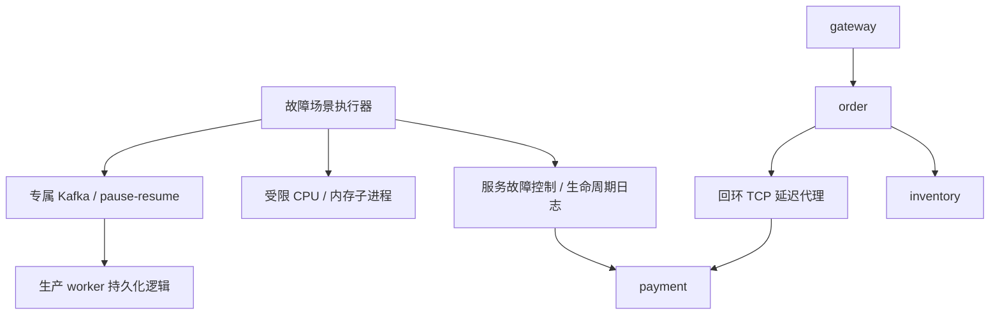

# 第五阶段：部署、场景与安全边界

基于第四阶段增量升级。检测算法、事件 schema v1、RCA、报告和现有数据库表均保留。新增故障控制和验收工具；无需 LLM API 密钥。完整测试使用 Linux/WSL、Python 3.11/3.12、Java 17；HTTP 小场景不需要 Java，资源压力必须在支持 resource 限制的 Linux 上显式启用。

## 从干净环境复现

在解压后的 `aiops-platform` 目录执行：

```bash
python3 -m venv .venv
. .venv/bin/activate
pip install -r requirements.txt
python -m unittest discover -s tests -v

# 首次需联网下载 Kafka 3.9.1，并验证 Apache 发布的 SHA-512。
# 系统需提前安装 Java 17；脚本不安装系统软件、不启动常驻服务。
python -m scripts.bootstrap_fault_kafka --runtime-dir /tmp/aiops-phase5-kafka

# 每次使用一个不存在的新输出目录；不会覆盖已有结果。
python -m scripts.verify_faults --output artifacts/my-phase5 \
  --allow-resource-pressure \
  --kafka-home /tmp/aiops-phase5-kafka/kafka_2.13-3.9.1
```

完整命令启动本次专属 API + 四个 HTTP 服务、回环 TCP 代理和专属 Kafka broker，验证后停止。本轮实际执行 10 类场景，46 个断言。测试只有小规模、固定边界的注入，不是第六阶段的容量压测。

不提供 `--kafka-home` 时，Kafka 场景标记 blocked；不提供 `--allow-resource-pressure` 时，CPU/内存标记 skipped。退出码：0=全部所选场景通过，1=失败/中断/清理失败，2=存在 skipped/blocked。此时已执行的结果仍保留，不能把退出2算全通过。

## 每个场景单独执行

```bash
python -m scripts.verify_faults --scenario http_5xx --output artifacts/one-5xx
python -m scripts.verify_faults --scenario latency --output artifacts/one-latency
python -m scripts.verify_faults --scenario timeout --output artifacts/one-timeout
python -m scripts.verify_faults --scenario unavailable --output artifacts/one-unavailable
python -m scripts.verify_faults --scenario network_delay --output artifacts/one-network
python -m scripts.verify_faults --scenario cpu --allow-resource-pressure --output artifacts/one-cpu
python -m scripts.verify_faults --scenario memory --allow-resource-pressure --output artifacts/one-memory
python -m scripts.verify_faults --scenario cascade --output artifacts/one-cascade
python -m scripts.verify_faults --scenario messages --output artifacts/one-messages
python -m scripts.verify_faults --scenario backlog --kafka-home /tmp/aiops-phase5-kafka/kafka_2.13-3.9.1 --output artifacts/one-backlog

# 也可只运行 Kafka 测试，不启动 HTTP 服务：
python -m scripts.verify_fault_kafka --kafka-home /tmp/aiops-phase5-kafka/kafka_2.13-3.9.1 --output artifacts/kafka-only
```

| 场景 | 实际机制 | 预期与清除 |
| --- | --- | --- |
| http_5xx | payment `/work` 返回503 | 原路清除后 gateway 200 |
| latency | 可取消的异步延迟220ms | 实测延迟；none/TTL/替换取消等待 |
| timeout | 等待1200ms使真实HTTP客户端100ms读超时；4500ms等待使order的3s下游调用超时 | 直接ReadTimeout、order 504；清除后200 |
| unavailable | 停止本次拥有的payment进程 | 连接拒绝、gateway 502；启动同端口新进程恢复 |
| network_delay | order→payment 的真实 TCP 请求流每块最多注入240ms延迟 | 真实传播延迟；clear/到期停止，保持长连接也生效 |
| cpu | 专属Python子进程占空比循环 | 观测CPU时间；期限到后释放，父进程回收 |
| memory | 专属子进程实际分配并逐页触碰16MiB | 分配前后实际RSS增加；退出释放 |
| cascade | payment503→order502→gateway502，inventory200 | 同trace证据，现有快速检测生成三个服务告警 |
| messages | 真实HTTP发重复、冲突、乱序及6类坏数据 | 5条唯一事件、1条冲突隔离、非法输入400；数据不作为“故障标签”传入诊断 |
| backlog | 本次专属Kafka、独立consumer group，pause→生产64条→resume | lag 64→0；55唯一入库、7条隔离，持久化后commit64 |

消息类测试可重复运行；事件ID按run随机隔离、输入次序和预期数量固定。开始/结束时刻和耗时是实际时钟，不保证两次测量的毫秒数相同。消息的乱序验收覆盖真实传输、存储和共享聚合策略，Flink水位线/迟到输出还须用前阶段原生链路工具独立复测。

## 结果与审计

- `completed.json`：HTTP套件清理完成后一次写入的最终记录，包含环境、配置、每个场景、开始/结束时间、影响范围、原始观测、断言和进程退出码。只有终态文件存在才视为一次完整运行。
- `result.json`：运行中进度快照；完成时更新。外部工具在执行期间复制的快照可能停留在running，不作为终态验收。
- `scenarios.csv`：场景摘要，便于后续性能工具汇总。
- `fault-audit/*.jsonl`：模拟服务开始、替换、清除、到期和正常关闭记录；最近256条可由`GET /fault/history`读取。持久日志不进入遥测/RCA证据集。
- `logs/*.log`：API/服务启动、错误和退出日志。
- `kafka/result.json`、`kafka/checks.csv`：真实broker验收与lag、消费延迟、持久化/commit结果。
- 每次新输出目录内的测试数据库与生产/历史数据库隔离。归档交付不包含可重建的Kafka segment；原始观测JSON、日志和测试数据库保留。

正常场景结束、失败、Ctrl+C/SIGTERM均执行清理。SIGKILL、断电不可能保证finally执行；服务请求故障有TTL，资源worker有自身alarm和内核限制。此类强制退出的JSONL可能只有started没有ended，应标记结束未知，不能冒充已清除。TCP代理最长连接15s、最多32连接，关闭后取消全部任务。测试不操作第三方/外部地址，不执行宿主机tc/iptables，不杀用户已有进程。

## 持续运行服务的控制

```bash
python -m scripts.local_platform
curl -X POST http://127.0.0.1:8000/faults/payment \
  -H 'Content-Type: application/json' \
  -d '{"kind":"timeout","duration_seconds":10,"latency_ms":4500}'
curl -X POST http://127.0.0.1:8000/faults/payment \
  -H 'Content-Type: application/json' -d '{"kind":"none"}'
```

旧`latency/error/none`参数与响应字段保留，新增`timeout/unavailable`及`fault_id`。API的`unavailable`为业务503；真正停止进程由隔离场景脚本完成，避免远程API具备任意进程控制能力。`timeout`使用明确的延迟，是否观察到超时取决于调用方timeout；不会伪造超时异常。

| 配置 | 默认 | 说明 |
| --- | --- | --- |
| SIMULATOR_DOWNSTREAM_TIMEOUT_SECONDS | 3 | 0.05–30秒，所有服务下游客户端 |
| SIMULATOR_CONTROL_TOKEN | 空 | 非空时模拟服务控制接口必须有x-simulator-token；API转发此值 |
| SIMULATOR_FAULT_AUDIT_DIR | 本地启动器自动设为data-dir/fault-audit | 直接运行service不设置则仅保留内存历史和日志；Compose为容器/tmp路径 |

平台顶层API没有新增登录认证；控制台仍只允许本机/受信任隔离网络使用。服务token保护的是服务控制入口，不替代平台API的鉴权。远程暴露前必须先补齐认证、权限和TLS。Compose仍仅对外绑定127.0.0.1，本轮只做静态检查，不声明Docker实际部署成功。Compose审计目录随容器删除而消失，需要长期保留时显式挂载；本阶段不改已有卷和数据库。

资源压力无远程接口，默认关闭，只有CLI显式参数启用。最大单次10s、单worker、32MiB分配、25%单核目标占空比；内核CPU时间硬限4s、地址空间192MiB、禁止core dump、独立alarm、父进程等待超时后terminate/kill。占空比为调度目标，不是cgroup硬CPU配额；测量来自专属子进程，不代表宿主机整体负载，也不保证触发现有主机异常阈值。多个独立命令并发的总资源不由全局配额控制，勿批量并发压力命令。

## 组件关系



服务遥测仍通过现有HTTP入口进入Pipeline→检测→事件→报告，不带注入标签。独立Kafka测试使用同一生产`persist_batch`及共享Flink parser/聚合代码，但**没有启动Flink引擎**；不能把该测试表述成Kafka+Flink全链路验收。

实现参考：Python [resource](https://docs.python.org/3/library/resource.html)、[asyncio streams](https://docs.python.org/3/library/asyncio-stream.html)、Kafka Python [Consumer API](https://kafka-python.readthedocs.io/en/2.1.3/apidoc/KafkaConsumer.html)。实际依赖版本和环境以本轮`dependency-freeze.txt`及验收JSON为准。
