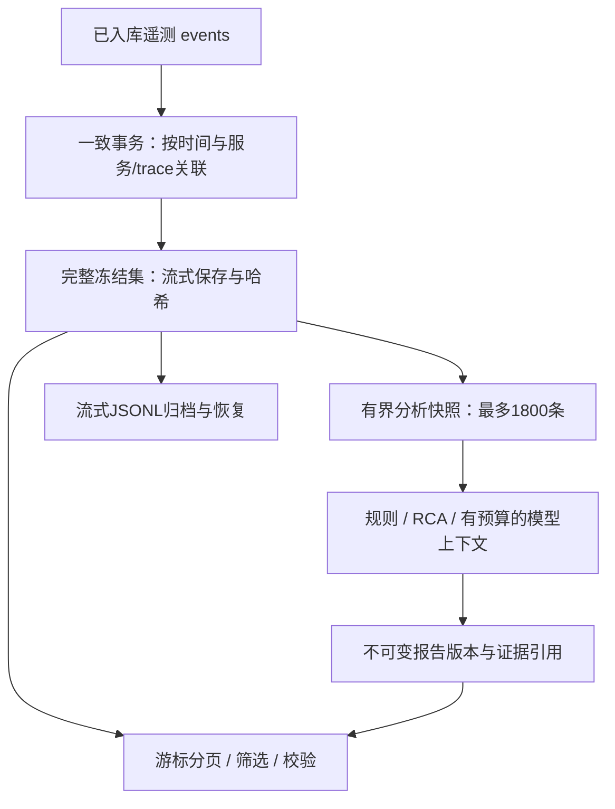

# 第八阶段证据管理部署与架构

## 安装、启动与兼容性

从项目根目录执行。Python 3.11 / 3.12 的本轮结果见验收报告；SQLite 需包含 JSON 函数（本轮使用版本记录在结果 JSON）。沿用已固定的 `requirements.txt`，本阶段无新增第三方依赖。

```bash
python -m venv .venv
. .venv/bin/activate
python -m pip install -r requirements.txt
python -m unittest discover -s tests -v

# 查询 API，默认只监听本机。已有 worker/本地采集服务继续按原部署指南启动。
DATA_DIR=./data python -m uvicorn app.api:app --host 127.0.0.1 --port 8000
# 无 Kafka 的本地采集模式使用 app.local_api:app，证据路由相同。
```

启动所使用的 `DATA_DIR` 必须与 worker 一致。不要把测试结果目录误当成生产目录。首次打开旧数据库时，先用 SQLite online backup 创建 `DATA_DIR/backups/before-phase8-*.sqlite3`，校验备份后在单个事务内新增 `evidence_sets`、`evidence_records`、索引和 `phase8-v1` 迁移记录。既有表和报告内容不改写，备份失败则中止该次初始化。空白数据库直接初始化，不创建无意义的空库备份。

回退应用前停止写入者；旧代码可以忽略新增表，但它不支持完整证据分页。需要恢复数据库时，先保留当前库及 WAL/SHM 的一致备份，再按第七阶段恢复指南操作；本阶段不会自动覆盖数据库。

| 配置 | 默认 | 范围/含义 |
| --- | --- | --- |
| `EVIDENCE_OPERATION_TIMEOUT_SECONDS` | 30 | 1–120 秒；冻结、分页查询和完整校验的截止时间，超时返回存储错误/503，不提交半成品 |
| `EVIDENCE_RETENTION_DAYS` | 30 | 7–3650 天；原始事件清理的最短年龄，同时检查事件时间和接收时间 |
| `DB_TIMEOUT_SECONDS` | 3 | 沿用第七阶段锁等待限制；大批冻结时并发请求可能短暂返回 503 |
| `DATA_DIR` | data | 原始事件、冻结集、报告和迁移记录使用同一个 SQLite 文件 |

Compose 已传入两个新增变量，但当前环境没有 Docker，本轮不宣称容器启动验证通过。模型地址、模型名和密钥仍通过原有环境变量配置；本阶段集成脚本明确关闭外部模型，无外部调用费用。

## 数据流与完整性定义



关联范围仍为告警/故障窗口前后各 5 秒，选取同服务事件及该服务事件的非空 trace 关联事件。查询不再先截取时间范围前 20,000 条。按 `(event_time,event_id)` 排序，每批最多 200 行复制到完整集，分析快照仍优先保留错误与 span，最多 1,800 条。模型另有既有上下文预算，不因全量保存而增加模型调用次数。

| 字段 | 含义 |
| --- | --- |
| `snapshot.full_evidence.set_id` / `audit.full_evidence_set_id` | 完整冻结集 ID，覆盖本次查询事务已入库的所有匹配事件 |
| `audit.evidence_set_id` | **保留原义**：模型实际输入的证据集 ID |
| `rca.evidence_set_id` | **保留原义**：RCA 的分析快照 ID |
| `snapshot.full_evidence.total_count` | 完整存储条数，不是模型输入条数 |
| `snapshot.full_evidence.service_counts/type_counts` | 精确分组计数；最多列出 500 个分组，超出有独立 `truncated` 标记 |
| `audit.evidence_completeness=stored_query_complete` | 完整集已保存，分析快照也包含全部匹配记录；不代表跨主题遥测已全部到齐 |
| `audit.evidence_completeness=analysis_sampled` | 完整集已保存，但分析快照截断，报告分析未覆盖全部证据 |
| `legacy_unknown` | 老报告没有完整冻结集，不能用今天的数据库补写成“原报告完整” |
| `audit.referenced_evidence_ids/count` | 分析结论及 RCA 实际引用的事件 ID；生成报告前校验均存在于分析快照 |
| `coverage.truncated` / `audit.analysis_truncated` | 分析快照是否被数量预算截断；不能据此说完整存储集丢失 |

同一内容和查询生成相同完整集 ID，重复消息不重复入集。新到证据生成新集；活动故障的新证据能够推动报告新版本，即使 trace 缺失计数没有改善。旧版本保持不变。沿用既有生命周期：已结束的故障不会自动重开并重新诊断迟到数据。

哈希算法 `sha256-concat-record-sha256-v1`：每个原始记录 `{event,source,ingested_at}` 经项目 `canonical` 序列化并 SHA-256；按排序顺序拼接每个哈希的 **32 字节二进制值**，再次 SHA-256。完整集 ID 再绑定查询、总数、流哈希、算法和分类统计。校验还检查连续序号、排序、索引列与原文一致、分析样本确实属于完整集，以及报告引用清单。此机制是本地一致性校验，不是外部签名，也不是消息交付 watermark。

## API：分页、筛选、历史比较

| 路径 | 返回与限制 |
| --- | --- |
| `GET /evidence-sets/{set_id}` | 冻结集查询、统计和内容哈希 |
| `GET /evidence-sets/{set_id}/records` | 默认 200 条、最多 500 条；`next_cursor=null` 表示结束 |
| `GET /evidence-sets/{set_id}/verify` | 流式完整性校验；完整处理失败不会返回成功 |
| `GET /report-versions/{report_id}/evidence` | 读取该版本的冻结集；历史版本只分页返回原有快照，并标记完整性未知 |
| `GET /reports/{report_id}/evidence` | 兼容原告警报告，含相同筛选与历史降级语义 |
| `GET /incidents/{incident_id}/evidence` | 取得最新报告的第一页，返回固定 `report_id` / `set_id`；后续通过这两个固定 ID 路由翻页 |
| `GET /incidents/{incident_id}/report-history` | 版本升序分页，默认 100、最多 500；并发追加的新版本可能出现在后续页 |
| `GET /report-versions/{before}/compare/{after}` | 同故障版本比较；新增、删除、内容改变的**全量计数**，ID 样例默认 100、最多 500，并标记样例截断 |
| 原 `/reports`、`/incidents/{id}/reports` | 保留原列表响应；只从 SQL 返回摘要。故障旧列表最多最近 500 个，完整历史走新分页接口 |
| 原报告 `/verify`、`/markdown` | 增加完整证据验证结果/说明，保留快照与 RCA 校验字段 |

证据页支持组合参数：`service`、`event_type`（request/span/log/host）、`event_id`、`trace_id`、`start`、`end`。时间为 UTC epoch 毫秒，两端包含。`cursor` 绑定完整集和筛选条件；换筛选条件需从第一页开始。非法条件返回 422，不存在返回 404，存储失败返回 503。游标不是认证凭据；已有本机访问范围不变，未提供远程删除 API。

```bash
curl 'http://127.0.0.1:8000/incidents/INCIDENT_ID/evidence?page_size=200'
curl 'http://127.0.0.1:8000/evidence-sets/FULL_SET_ID/records?service=payment&event_type=span&page_size=200'
# 下一页保留同样筛选参数，再带上返回的 cursor。
curl 'http://127.0.0.1:8000/evidence-sets/FULL_SET_ID/verify'
curl 'http://127.0.0.1:8000/report-versions/BEFORE_ID/compare/AFTER_ID?sample_limit=100'
```

控制台增加完整条数与分析截断说明、证据筛选和“下一页”，每次仅显示当前页，不在浏览器累积全量记录；可比较上一版本。界面 JS 已执行语法检查，业务接口经过真实 HTTP 测试；本轮未执行浏览器点击端到端测试。

## 归档、保留和清理

```bash
# 文件名必须未存在；不会覆盖原归档。归档格式为 gzip JSONL，头/记录/尾，包含条数与哈希。
python -m scripts.evidence_admin --data-dir ./data archive \
  --set-id FULL_SET_ID --output ./archives/incident-evidence.jsonl.gz
python -m scripts.evidence_admin verify-archive --input ./archives/incident-evidence.jsonl.gz

# 恢复原始事件及来源/接收时间到独立目录；先备份目标库，再事务恢复。
python -m scripts.evidence_admin --data-dir ./restored-data restore \
  --input ./archives/incident-evidence.jsonl.gz

# BEFORE_MS 必须早于当前时间减去保留天数；第一条仅预览，不删除。
python -m scripts.evidence_admin --data-dir ./data prune \
  --before BEFORE_MS --batch-size 500 --output-dir ./archives
# 审核预览后，显式 --apply：在线备份→写归档→重新读校验→删除这一个批次。
python -m scripts.evidence_admin --data-dir ./data prune \
  --before BEFORE_MS --batch-size 500 --output-dir ./archives --apply
```

- 每次只处理一个批次（1–500 条），没有无限清理循环。操作持有应用数据库锁并受截止时间约束，可能短暂影响采集，应安排低负载维护窗口。
- 活动故障的完整原告警窗口及之后数据受保护；未报告告警也保护其窗口及之后数据。该时间保护有意保守，可能连带保留无关服务的旧数据。新近接收的晚到事件不会因为事件时间旧而立即被清理。
- 只清理 `events` 原始表；冻结证据、所有报告、告警、故障状态、备份均保留。旧报告不会获得其从未保存的完整证据，系统不自动声称补齐。
- 归档、哈希校验、备份或事务失败时不删除原始事件；若归档已发布而删除回滚，该额外归档可留作审计，不会丢失数据。
- 恢复时同 ID 的内容、来源或接收时间不一致即拒绝并整体回滚；完全相同记录幂等跳过。缺少尾记录、内容哈希不符或 manifest 改动均拒绝。
- 归档单行最大 2 MB，超出拒绝并保留数据库数据；库本身沿用事件契约。恢复也有操作截止时间，不能视为任意大数据的无限作业。
- 没有自动清理冻结集/历史报告/备份，也不自动启用计划任务。不同证据版本可能重复占用磁盘；应监控磁盘并按研究/审计要求归档。跨版本对象去重、离线档案查询和长期自动淘汰尚未实现。

## 复现验收

```bash
python -m unittest tests.test_evidence_phase8 -v
python -m scripts.verify_evidence --output artifacts/evidence-run-01 --count 23005
# 可追加 --legacy-source /absolute/path/to/a/quiesced/phase7/aiops.sqlite3
# 仅复制该旧库并升级副本，不修改源数据库。

# 既有 Kafka/Flink 原生环境（需 Linux/Java17/Python3.11，安装方式沿用前阶段指南）
python -m scripts.bootstrap_native --runtime-dir /tmp/aiops-native-runtime
/tmp/aiops-native-runtime/venv/bin/python -m scripts.native_streaming \
  --runtime-dir /tmp/aiops-native-runtime --output artifacts/native-phase8-run-01
```

结果目录必须是新路径。`verify_evidence` 真实启动并重启 Uvicorn，使用实际 SQLite、HTTP、归档和删除事务；输入明确为合成遥测，不冒充真实生产流量或模型推理。其计时是单次观察，包含测试环境开销；峰值内存由 Python tracemalloc 记录，不是进程 RSS，也不是容量承诺。原生 Kafka/Flink 是另外一次真实运行，不能将证据 HTTP 测试算作消息链路测试。
