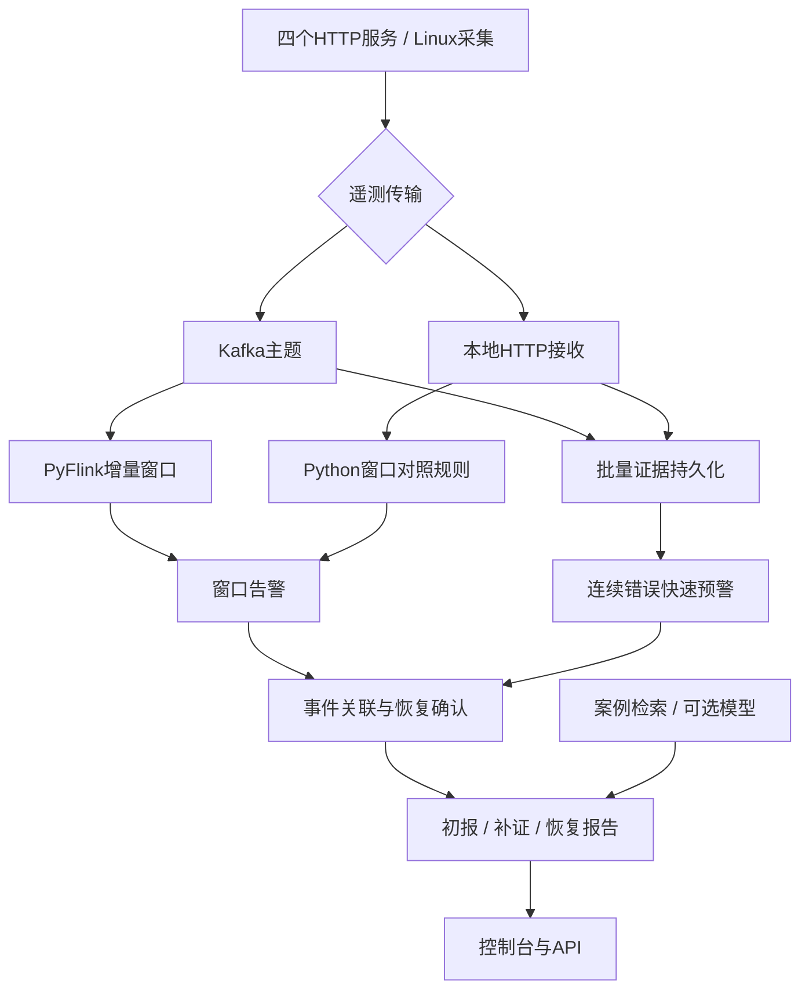

# 分布式智能运维平台 v0.2：系统设计与路线图

平台已经提供真实服务调用、实时采集、异常检测、事件关联、证据诊断、分版本报告和恢复确认。大模型承担证据解释与候选原因分析；检测、持久化、引用校验和事件状态由确定性代码控制。本地持续运行入口是`python -m scripts.local_platform`，浏览器访问8000端口；Kafka/Flink部署定义与本地模式共享后续事件、证据和报告流水线。

## 1. 两种运行路径

四个独立服务构成`gateway → order → inventory / payment`。请求传递trace_id及父span_id，服务产生请求指标、日志和span。故障控制提供有持续时间上限的延迟及HTTP错误，控制面记录与诊断输入隔离。本地模式使用真实TCP调用、HTTP遥测和Python规则，已完成故障周期验证；它不执行Kafka或Flink引擎。标准容器路径中的真实PyFlink作业尚需Linux容器联调。

| 模块 | v0.2职责 |
| --- | --- |
| 模拟服务 / Linux Agent | 真实请求传播、故障控制；只读采集可见CPU、内存和负载 |
| Kafka / Flink | 遥测解耦；事件时间、乱序容忍、增量聚合、过迟事件隔离 |
| Python Pipeline | 批量写入、快速检测、事件关联、恢复与报告调度 |
| SQLite | 原始证据、告警、事件、不可变报告版本及幂等通知箱 |
| 诊断与检索 | 元数据/关键词案例检索，可选兼容chat接口模型；引用校验和回退 |
| FastAPI / 控制台 | 服务和事件查看、故障控制、报告及证据核验 |

## 2. 数据契约和检测

遥测JSON包含`schema_version、event_id、event_time、event_type、service、instance_id、trace_id`。时间使用Unix毫秒；event_id用于去重。Kafka使用`telemetry.metrics、telemetry.logs、telemetry.spans、ops.alerts、ops.deadletter`。标准路径保存topic/partition/offset；本地路径显式标记local-http或local-proc来源，不伪造Kafka坐标。

检测采用双通道。快速通道按服务与实例识别连续5个5xx，间隔超过5秒或出现健康请求重置，用于尽早发现不可用。确认通道按服务计算30秒窗口、每10秒滑动，容忍5秒乱序，空闲分区10秒idle。请求至少20个样本，P95>800ms或错误率>20%告警；主机至少3个样本，CPU或内存窗口均值>90%告警。阈值是演示起点，应根据SLO调整。

Flink v2维护计数、错误数、资源和以及25ms延迟直方图，普通范围60秒。P95返回最近秩桶上界，正常范围高估小于25ms；800ms处于桶边界，保持该阈值判断。超过60秒的溢出桶单独标注精度限制。为了精确去重，仍存储event_id及紧凑检测值，状态随唯一事件数线性增长。v2算子状态与v1不兼容，升级需要全新提交并重放Kafka，不能直接恢复v1 checkpoint。本地精确规则作为对照继续保留。

Flink checkpoint保护计算状态，Kafka输出至少一次。稳定alert_id、数据库幂等写入和通知唯一键处理重放。该组合没有端到端exactly-once承诺；当前也没有跨主机高可用。

## 3. 从告警到事件，再到恢复

滑动窗口告警是观测，事件是一次持续故障。平台依据规则族、候选叶子服务/实例、时间范围和共同异常trace关联；跨服务合并要求共同证据，只有拓扑相同或时间接近不足以合并。证据不足时保留服务级事件，补证后可升级关联。payment故障传播到order和gateway时，可形成一个availability事件，保留所有原始告警。

事件状态为`open → recovering → resolved`。恢复要求受影响服务最近10秒各至少10个健康请求、数据新鲜度不超过5秒、采样跨度和最大间隔满足条件，再健康保持10秒。中断、样本不足或再次出现异常会撤销恢复计时。资源类事件使用相应主机指标条件。历史窗口迟到可增加事件的历史告警计数，不能把旧故障重新打开，也不改写已冻结的恢复报告。

打开与恢复各产生一条幂等本地通知记录。当前通知箱只有持久化和查询，不向外部渠道发送，也没有自动修复动作。

## 4. 渐进报告和证据链

事件打开后先冻结`preliminary`初报，不等待或调用模型。最少3秒后，在观测链满足条件时生成`enriched`；等待上限15秒，超时保留缺失项。关联服务、候选服务或链路缺失改善可产生额外补证版本。恢复后生成`resolved`最终版本，之后保持不可变。异步调度避免一个慢模型任务阻塞其他事件初报。

每个版本从告警窗口和事件时间边界收集证据，经trace_id扩展上下游；保存查询范围、截断上限、缺失父子span/日志和覆盖统计。模型上下文优先保持整条已观测trace，并包含健康对照。报告冻结原始快照、SHA-256、案例内容与版本、提示词模板和输入哈希、模型元数据及引用。补充证据通过新版本表达，原版本不会覆盖。

每个事件最多一次自动模型尝试。无配置、失败或无效引用均明确标记规则回退，避免把启发式结论称为模型结果。模型引用存在不等于推理正确；完整观测链也不能证明跨Kafka主题已全部到齐。相似案例只支持提出候选解释。异常叶子payment可以是优先调查对象，内部原因仍可能是网络、共享数据库或配置变化，需要额外证据验证。

## 5. 验收结果和后续路线

最新110秒真实本机运行使用35秒健康、30秒支付错误、45秒恢复，产生3946条事件、18条告警，关联为1个故障事件，生成4版报告和2条本地通知；8项检查及54项自动测试通过。最后恢复报告明确标记1800条快照上限造成的部分证据；冻结时告警数15，历史补入后实时事件计数18，原报告保持不变。注入约1.62秒后出现初报，清除约20.45秒后确认恢复。完整产物见`examples/optimized-*`及《验证记录.md》。这是一次低流量本机验证，不是吞吐或可用性SLA；没有真实模型调用和Kafka/Flink容器运行结果。

下一阶段先扩充多故障并发、迟到和遥测中断回归集，导入真实复盘案例，增加人工确认；再接入OpenTelemetry、PostgreSQL/ClickHouse与语义检索，建设鉴权、脱敏和数据保留策略；最后进行多节点容错、容量与反压测试、模型质量评估及受控修复。根因Top-1/Top-3评分使用独立注入真值，真值不得进入诊断输入。生产部署前还需解决SQLite写入能力、节点资产映射、日志隐私和快照保留成本。
