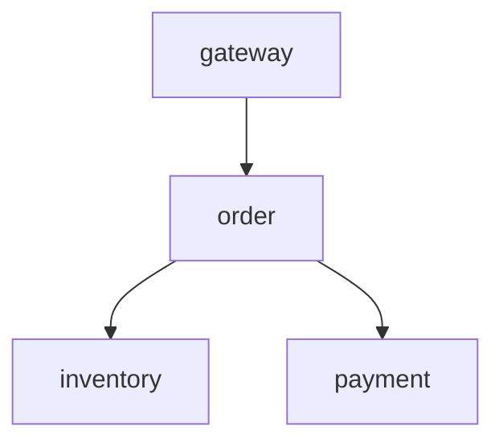

# 第五阶段补充

新功能与完整命令以[第五阶段指南](../docs/phase5/故障注入部署与架构.md)为准：新增timeout/unavailable、独立审计与受限资源/网络/消息场景。资源压力无远程接口，默认关闭；所有套件只测试自建隔离本机进程。

`GET /fault/history`返回最近256条控制记录；审计文件保存started/ended、scope与结束原因。`SIMULATOR_CONTROL_TOKEN`非空时，直接调用三个fault接口均需`x-simulator-token`。控制信息不进入遥测。

以下保留原有四服务说明；下游timeout默认3s但可配置。清除、TTL到期、替换会取消正在等待的注入延迟，取消检查间隔不超过50ms。Compose实际运行本轮仍未验收。

# 分布式服务模拟器

四个独立进程通过真实 HTTP 调用形成调用图：



`gateway → order → inventory → payment` 按调用顺序执行，父 span 包含子调用耗时。每个服务仅对 `/work` 请求产生自身的请求指标、日志、server span；`x-trace-id` 和 `x-parent-span-id` 贯穿服务调用。这里是轻量的演示链路协议，未实现完整 OpenTelemetry / W3C Trace Context 规范。

服务间 HTTP 客户端和请求生成器均直连明确配置的服务地址，不继承运行环境中的 HTTP/SOCKS 代理设置，以便容器内部网络与本机回环地址保持可达。

## 运行环境

| 环境变量 | 默认值 | 用途 |
| --- | --- | --- |
| `SERVICE_NAME` | `gateway` | `gateway/order/payment/inventory` 四选一 |
| `INSTANCE_ID` | 容器 hostname | 区分服务实例 |
| `KAFKA_BOOTSTRAP_SERVERS` | `localhost:19092` | 逗号分隔 Kafka 地址；Compose 使用 `kafka:9092` |
| `TELEMETRY_MODE` | `kafka` | `memory` 仅用于本地测试；`http` 用于无 Kafka 的显式本地演示 |
| `TELEMETRY_HTTP_URL` | `http://127.0.0.1:18100/demo/ingest` | `http` 模式的遥测接收地址 |
| `ORDER_URL` | `http://order:8000` | gateway 的下游 |
| `INVENTORY_URL` | `http://inventory:8000` | order 的库存下游 |
| `PAYMENT_URL` | `http://payment:8000` | order 的支付下游 |

Docker 构建上下文是项目根目录，Dockerfile 为 `simulator/Dockerfile`。默认命令：

```bash
uvicorn simulator.service:app --host 0.0.0.0 --port 8000
```

## 接口

| 接口 | 行为 |
| --- | --- |
| `GET /health` | 存活状态和遥测发送/失败计数；不调用下游 |
| `GET /work` 或 `POST /work` | 执行服务工作，调用下游并返回链路 ID |
| `GET /fault` | 查看当前故障控制及剩余时间 |
| `POST /fault` | 设置或清除可逆故障 |

例如，在能访问 payment 容器的网络内注入请求延迟：

```bash
curl -X POST http://payment:8000/fault \
  -H 'Content-Type: application/json' \
  -d '{"kind":"latency","duration_seconds":120,"latency_ms":1500}'
```

注入错误：

```json
{"kind":"error","duration_seconds":120,"error_rate":1.0}
```

立即恢复：

```json
{"kind":"none"}
```

故障仅影响 `/work`：延迟使用异步等待，错误返回 HTTP 503，不消耗主机 CPU 或内存。允许持续 1–600 秒，延迟 0–10000 毫秒，错误概率 0–1；到期后新请求自动恢复。已进入等待的请求在清除、到期或替换时取消注入等待。下游超时为 3 秒，上游将观察到 504；下游错误由上游转为 502，因此能够模拟故障传播。

故障控制状态不会写入遥测事件。诊断端只能从延迟、状态码、日志与父子 span 判断原因。`/fault` 属于演示控制接口，部署时应保留在容器内部网络。

## 遥测

- `telemetry.metrics`：`event_type=request`，包含 `latency_ms`、`status_code`、`span_id`；HTTP 5xx 计为错误。
- `telemetry.logs`：每次请求的 INFO/ERROR 日志，故障传播时记录实际观察到的下游错误或超时。
- `telemetry.spans`：每个服务的 server span，包含 `span_id`、`parent_span_id`、起止毫秒时间和实际调用过的 `downstream` 服务。

三类事件都带 `schema_version=1`、唯一 `event_id`、`event_time`（UTC Unix 毫秒）、`service`、`instance_id`、`trace_id`，Kafka key 为服务名。Kafka producer 使用 `acks=all` 和重试；这不构成全链路 exactly-once 保证。启动时 Kafka 不可连接会使服务启动失败；运行期间发送失败会计入 `/health` 的 `telemetry_failed`，日志记录失败异常类型；本模拟器没有磁盘缓冲。

`TELEMETRY_MODE=http` 会将同一份事件同步 POST 到 `TELEMETRY_HTTP_URL`，JSON 格式为 `{"topic":"telemetry.metrics","event":{...}}`，每次请求超时 3 秒。服务中该调用在线程里执行，成功和失败分别计入健康接口中的遥测计数。此模式用于运行真实 HTTP 服务的轻量本地演示，不连接 Kafka，也不表示验证了 Kafka/Flink 集群。

## 持续请求

```bash
GATEWAY_URL=http://gateway:8000 LOAD_RPS=5 python -m simulator.loadgen
```

默认每秒 5 次请求，最多 50 个并发；每 5 秒输出状态码统计。故障恢复后继续请求，以便 Flink 事件时间水位线持续前进。可使用 `LOAD_MAX_CONCURRENCY` 修改并发上限；达到上限会跳过该次发起并计数。

## 本地测试方式

`create_app(Settings(...), telemetry=Telemetry(mode="memory"), transport=...)` 可注入 httpx transport；内存中的 `telemetry.events` 保存最近 20000 个 `(topic, event)`，不会伪装为 Kafka 已经接入。所有请求客户端都在 FastAPI lifespan 中创建、关闭，因此测试时要进入应用 lifespan。

参考：[FastAPI lifespan](https://fastapi.tiangolo.com/advanced/events/)、[FastAPI 错误处理](https://fastapi.tiangolo.com/tutorial/handling-errors/)、[kafka-python producer 配置](https://kafka-python.readthedocs.io/en/2.2.12/apidoc/KafkaProducer.html)。
